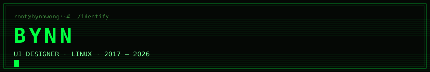
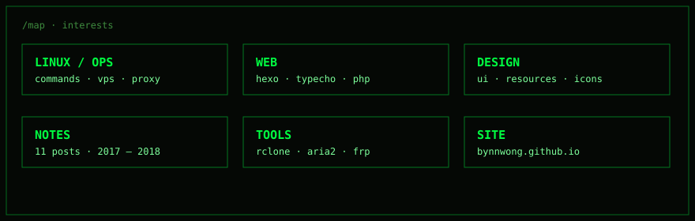
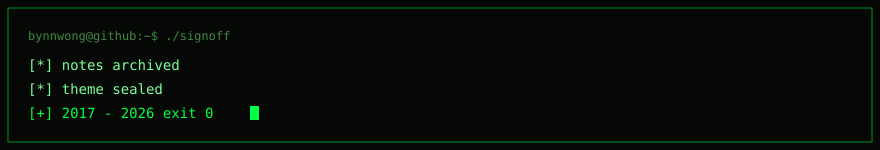

<p align="center">
  
</p>

<p align="center">
  
  
  
  
  
  
  
  
  
</p>

```txt
bynnwong@github:~$ cat /etc/motd
> UI designer
> linux notes, hexo, and small tools
> current site: bynnwong.github.io
> 全国步行公开赛第一名 · 纸折飞机赛第二名 · 偏执的射击师
```

### `/map`



### `/proc/now`

```txt
bynnwong.github.io     hacker-styled hexo blog
linux-command          linux command handbook
rclone                 cloud storage sync
v2ray                  one-click install notes
typecho                php blogging platform
hexo-theme-next        hexo theme
```

### `/usr/local/bin`

| bin | target |
| :-- | :-- |
| [`bynnwong.github.io`](https://bynnwong.github.io) | homepage |
| [`linux-command`](https://github.com/bynnwong/linux-command) | command notes |
| [`rclone`](https://github.com/bynnwong/rclone) | storage sync |
| [`hexo-theme-next`](https://github.com/bynnwong/hexo-theme-next) | blog theme |

```txt
bynnwong@github:~$ ./signoff
[*] notes archived
[*] theme sealed
[+] 2017 - 2026
```

<p align="center">
  
</p>
